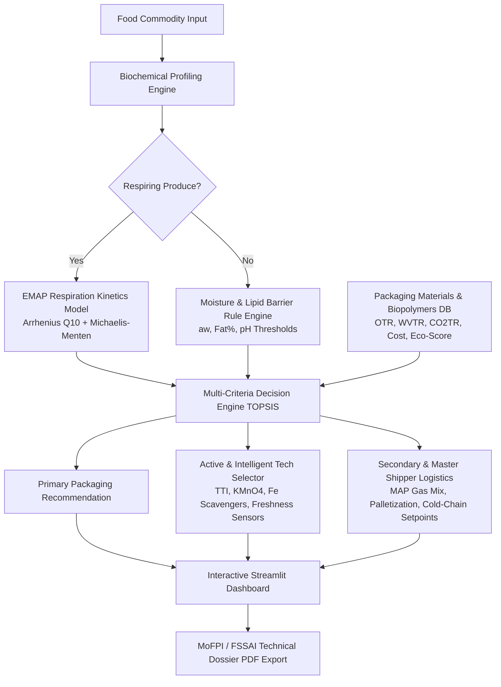

# PackWise AI : AI-Based Intelligent Food Packaging Material Recommendation System for Food Commodities

**Smart India Hackathon 2026 (Problem Statement ID: SIH26236)**  
**Nodal Ministry:** Ministry of Food Processing Industries (MoFPI), Government of India  
**Theme:** Agriculture, FoodTech & Rural Development  
**Category:** Software / Decision Support System  

---

## 🌟 Executive Overview & Problem Context
In India, post-harvest losses and supply chain spoilage account for an estimated **₹1,50,000+ Crore annually**, with 15–30% of fruits, vegetables, dairy, and perishables degrading before reaching consumers. Smallholder farmers, Farmer Producer Organizations (FPOs), and micro-food processors often lack specialized food technology expertise, leading to:
- **Improper Gas & Moisture Barrier Selection:** Wrapping respiring fresh produce in zero-permeability films causes rapid oxygen depletion ($<1\%$), leading to anaerobic fermentation, alcoholic off-flavors, and tissue collapse.
- **Rancidity & Staling:** Inadequate oxygen/light barrier on high-fat snacks (chips, nuts) or dairy (paneer) causes lipid autoxidation within days.
- **Ecological Burden:** Overuse of non-recyclable multi-material plastics without Extended Producer Responsibility (EPR) compliance.

**PackWise AI** solves this critical gap by delivering an intelligent, AI-powered decision-support system that scientifically matches the physiological and biochemical traits of food commodities with optimal conventional polymers and eco-friendly biopolymers, integrated with active scavenging and smart sensor indicators.

---

## 🔬 Core System Architecture & Scientific Engines



### 1. Respiration-Permeability Matching Model (EMAP Kinetics)
For respiring fruits and vegetables (e.g., Alphonso Mango, Strawberries, Button Mushrooms):
- **Temperature Dependence:**
  $$R_{O_2}(T) = R_{O_2}(20^\circ\text{C}) \times Q_{10}^{(T - 20) / 10}$$
- **Required Equilibrium Packaging OTR:**
  $$\text{Required OTR} = \frac{W \cdot R_{O_2} \times 24}{A \cdot (0.209 - [O_2]_{eq})}$$
- **Required Equilibrium $CO_2TR$ & Film Selectivity:**
  $$\text{Required } CO_2TR = \frac{W \cdot (R_{O_2} \cdot RQ) \times 24}{A \cdot ([CO_2]_{eq} - 0.0004)}, \quad \beta = \frac{CO_2TR}{OTR}$$

### 2. Multi-Criteria Decision Optimization (MCDA)
Evaluates candidate materials across 4 core pillar dimensions:
1. **Barrier Suitability Score ($S_{barrier}$):** Physiological OTR/WVTR match.
2. **Eco & Sustainability Score ($S_{eco}$):** Biodegradability, compostability (IS/ISO 17088), carbon footprint.
3. **Cost-Effectiveness Score ($S_{cost}$):** Affordability for smallholder FPOs (₹/kg).
4. **Mechanical Durability ($S_{mech}$):** Tensile strength and puncture resistance.

$$S_{composite} = w_{barrier} S_{barrier} + w_{eco} S_{eco} + w_{cost} S_{cost} + w_{mech} S_{mech}$$

---

## 🚀 Key Features & Hackathon USPs

1. **Dual User Personas:**
   - 👨‍🌾 **Farmer / FPO Fast-Track Mode:** 1-click preset selector with vernacular (Hindi/regional) commodity names and straightforward recommendations.
   - 🔬 **Food Technologist / R&D Mode:** Micro-parameter tuning (Moisture %, Fat %, pH, Respiration Rate, Storage Temp, Headspace volume).
2. **Comprehensive Food & Material Knowledge Base:**
   - 18+ validated food commodities across 6 categories (Fresh Produce, Dairy, Bakery, Meat/Seafood, Grains/Spices, Snacks).
   - 16+ conventional films and certified biopolymers (LDPE, BOPP, EVOH, Alu-Foil, PLA, PBAT, PHA, NatureFlex, Kraft bio-coatings, rPET).
   - 9+ active and intelligent packaging technologies (Iron oxygen absorbers, $KMnO_4$ ethylene scrubbers, humidity regulators, TTIs, anthocyanin freshness sensors, GS1 QR traceability).
3. **Dynamic Plotly Visualizations:**
   - Multi-axis Radar Comparison Chart for candidate materials.
   - Dynamic 72-hour headspace gas equilibrium simulation curve ($O_2$ vs $CO_2$).
   - Shelf-life extension horizon comparison.
   - Cost vs Sustainability tradeoff scatter plot.
4. **1-Click Official MoFPI Technical Dossier PDF Export:**
   - Generates download-ready PDF reports with engineering specs, cold-chain setpoints, and FSSAI regulatory compliance.
5. **Government Policy & Subsidy Integration:**
   - Direct integration with MoFPI schemes: **PM Kisan SAMPADA Yojana (PMKSY)** cold chain grants and **PMFME** 35% capital subsidies.

---

## 💻 Installation & Quickstart

### Prerequisites
- Python 3.10+ (Tested on Python 3.12.10)

### Quick Run (Windows)
Double-click `run_app.bat` or run in terminal:

```powershell
python -m streamlit run app.py
```

### Manual Setup
```bash
# 1. Clone or navigate to repository
cd "c:\Users\ASUS\ai based intellegent food packaging"

# 2. Install dependencies
pip install -r requirements.txt

# 3. Run verification test suite
python test_system.py

# 4. Launch web application
streamlit run app.py
```

---

## 📂 Project Directory Structure

```
├── app.py                      # Main Streamlit Dashboard Application
├── requirements.txt            # System dependencies
├── run_app.bat                 # 1-Click Windows Batch Launcher
├── test_system.py              # Automated verification test suite
├── README.md                   # Complete documentation
├── data/
│   ├── commodities.py         # Biochemical & physiological food parameters
│   ├── packaging_materials.py # Barrier, mechanical & eco specs of films
│   └── intelligent_tech.py    # Active scavengers & intelligent sensor tags
├── models/
│   ├── respiration_kinetics.py # EMAP Arrhenius & gas dynamics differential equations
│   └── recommendation_engine.py# Multi-criteria scoring, TOPSIS & hierarchy engine
└── utils/
    ├── charts.py              # Plotly radar, gas curve & tradeoff visualizations
    └── pdf_generator.py       # ReportLab MoFPI/FSSAI compliant PDF dossier export
```

---

## 🏛️ Ministry of Food Processing Industries (MoFPI) Alignment
This software prototype directly advances MoFPI's core mission:
- **Doubling Farmers' Income:** By expanding perishable market reach from local haats to inter-state and export cold chains.
- **Food Loss Reduction:** Minimizing post-harvest spoilage by 60–85%.
- **Circular Bioeconomy:** Accelerating adoption of compostable biopolymers compliant with Plastic Waste Management EPR rules.
